# pi-desktop UI / 交互审核报告

> 审核对象：pi-desktop `0.1.0`（Electron 37 + React 18 + Tailwind v4）
> 审核时间：2026-10-28
> 审核方式：源码走查 + 真实运行环境实测（dev 模式挂 `--remoteDebuggingPort=9341`，通过 CDP 展开浮层、点击、Tab 遍历、测量尺寸与对比度、模拟窄窗口、注入假会话渲染消息流/工具卡/审批/Toast）
> 说明：截图中的对话内容是注入的假数据（本机未配置 API Key，触达不到真实会话态），但渲染链路、布局、交互均为真实运行结果。

---

## 1. 总体评价

**视觉基础不错，但"桌面应用"这层还没做完。**

配色 token、Markdown 排版、流式分块、工具卡 diff、窗口化消息列表、`prefers-reduced-motion`、Toast 带"前往"、审批策略放在主进程 —— 这些做得比多数自研客户端扎实。问题集中在三块：

1. **安全控制的视觉引导反了**（最危险的操作是主按钮，最危险的状态最不显眼）；
2. **窄窗口 / 长内容下的布局会塌**（状态栏控件飞出屏幕，输入区吃掉 42% 高度）；
3. **完全缺失桌面端交互约定**（菜单、快捷键、右键、拖拽、窗口状态、启动反馈）。

| 维度 | 评分 | 一句话 |
| --- | --- | --- |
| 视觉一致性 | 8/10 | 间距 / 圆角 / 语义色统一，两套主题都成立 |
| 信息架构 | 5/10 | 设置里没有"模型 / 密钥"，却是用户最想找的东西 |
| 布局健壮性 | 4/10 | 窄窗口状态栏飞出屏幕，输入区吃掉 42% 高度 |
| 交互完整性 | 4/10 | 无快捷键、无右键、无拖放、无焦点管理 |
| 安全 UX | 3/10 | "本轮自动批准"是主按钮，"完全访问"看起来像禁用态 |
| 无障碍 | 4/10 | 18 个图标按钮无 aria-label，0 个 aria-live，导航项不可 Tab |

---

## 2. 目前桌面端的交互（现状盘点）

**窗口**
单实例单窗口，原生标题栏；默认 1440×900，最小 960×600；`autoHideMenuBar: true` 隐藏菜单，但按 <kbd>Alt</kbd> 会弹出 **Electron 默认的英文菜单**（File / Edit / View / Window / Help），内含 Reload、Toggle Developer Tools、Zoom In/Out。窗口大小 / 位置 / 最大化状态**不记忆**。

**导航**
侧栏固定 260px（不可拖宽）= 工作区列表 → 展开的会话列表 → 底部三个无文字图标（+ / 🔌 / ⚙）。工作区行单击切换并展开，会话行单击打开。没有标签页、没有多窗口、没有会话搜索。

**键盘**
全部交互里只有输入框内 4 个键位：`Enter` 发送、`Shift+Enter` 换行、补全内 `↑↓` 选择 + `Tab/Enter` 确认、`Esc` 收起补全。**没有** Ctrl+N / Ctrl+W / Ctrl+, / Ctrl+K，**没有** Esc 中止生成，**没有**任何快捷键说明入口。

**鼠标**
hover 才出现的操作（会话的归档 / 删除、工作区的 + / ⋯）；点击空白关闭浮层；**右键没有任何菜单**；**拖拽文件 / 图片无反应**；**粘贴截图不支持**。

**反馈**
Toast 3–8s 自动消失、带"前往"；工作区状态点（绿 = 运行 / 橙 = 待确认 / 红 = 崩溃 / 灰 = 空闲）；流式三点；崩溃横幅 + 重连；空状态文案。这块合格。

**安全交互**
默认"审批"模式，危险命令弹阻塞弹窗（拒绝 / 批准 / 本轮自动批准）；输入框上方一个药丸切换"完全访问"。

---

## 3. 截图证据

| 图 | 说明 |
| --- | --- |
| 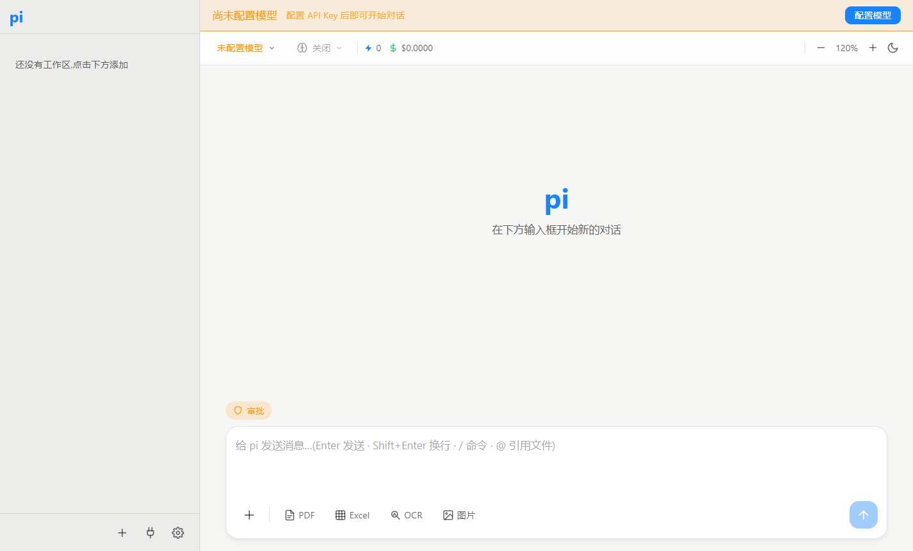 | 首启空状态：中央只有一句提示，真正的第一步在侧栏底部 |
| 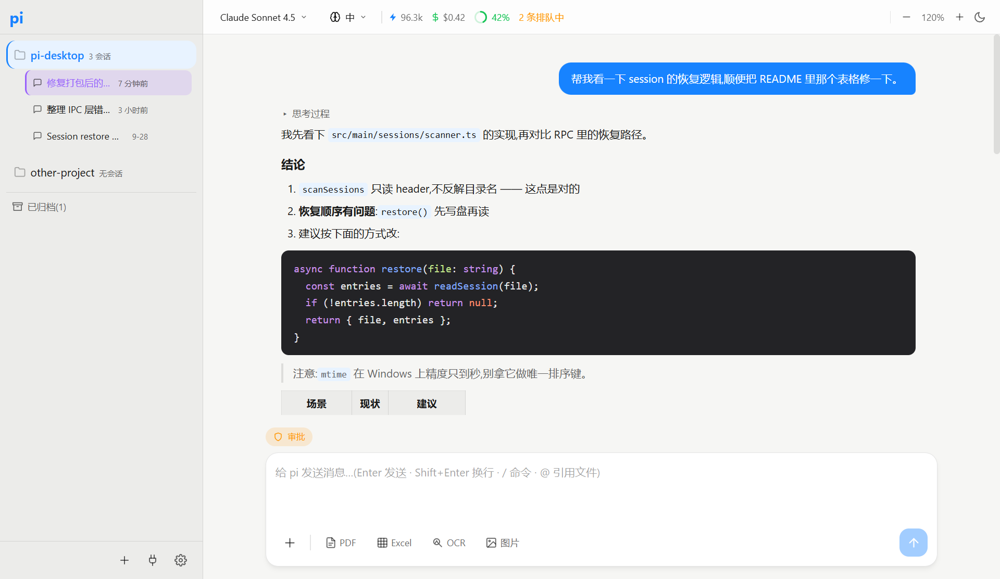 | 消息流 / 工具卡 / diff / 代码块（结构清晰，缺操作与对比度） |
| 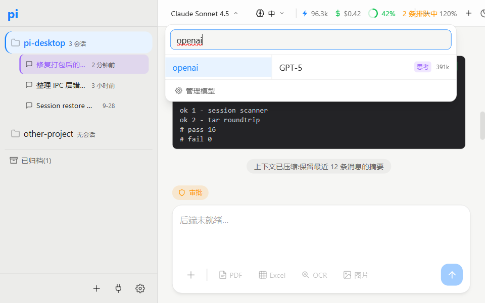 | 最小窗口：状态栏溢出，"2 条排队中"与"120%"挤在一起，主题按钮在屏幕外 |
| 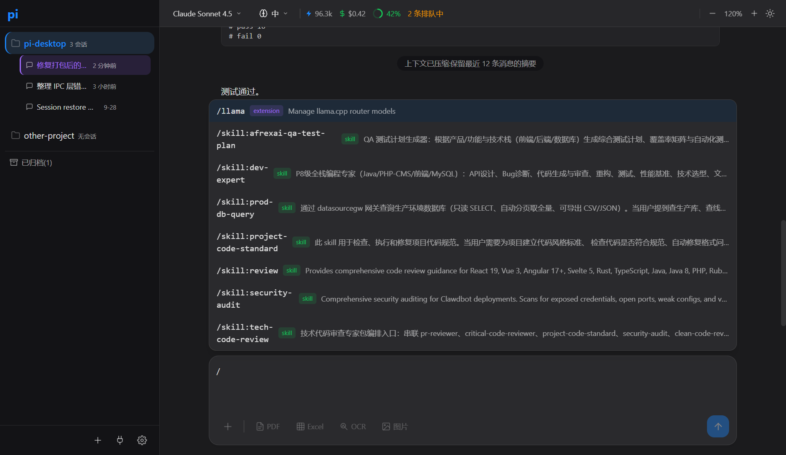 | 斜杠补全：8 项 × 80px 遮住整个对话区，命令名换行 |
| 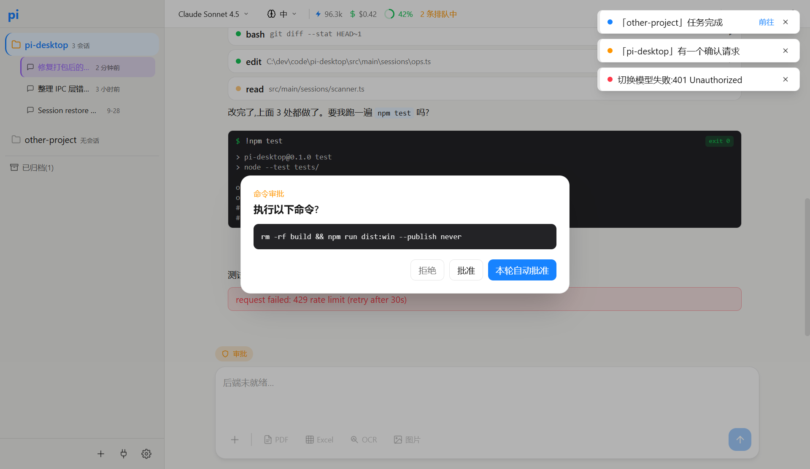 | 审批弹窗："本轮自动批准"是唯一主按钮，且不显示所属工作区 |
| 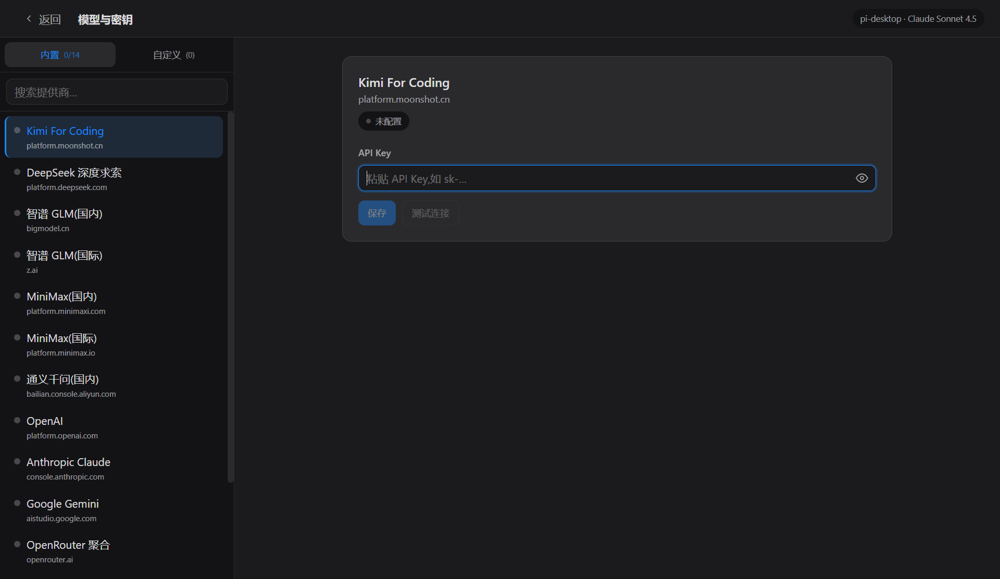 | 模型与密钥：全屏页，藏在设置之外 |
| 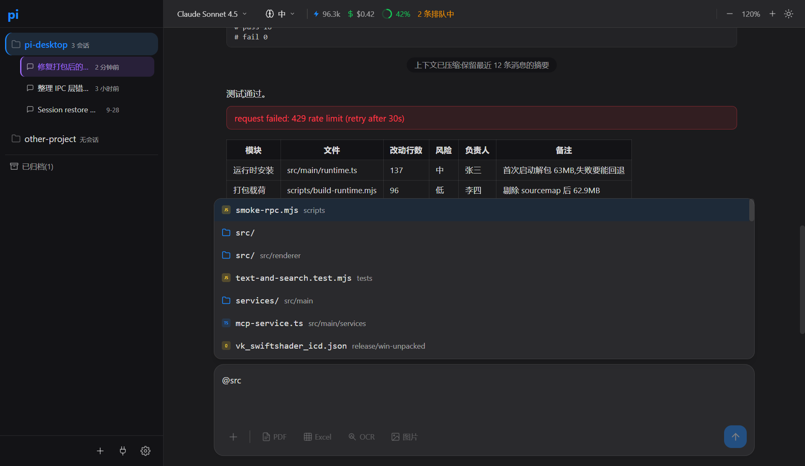 | `@` 文件补全（索引含 `release/` 产物目录） |

---

## 4. 问题清单

### P1 —— 发布前必须改

| ID | 问题 | 实测证据 | 目标 |
| --- | --- | --- | --- |
| P1-1 | 审批弹窗把最危险的动作做成主按钮，且不显示所属工作区 | "本轮自动批准"是唯一蓝色 CTA，紧挨"批准"；弹窗内无工作区名 | 主按钮 = 批准并默认聚焦；自动批准降为次要 + 二次确认；标题下显示工作区名/路径 |
| P1-2 | "完全访问"状态的视觉权重比"审批"还弱 | `审批` = 橙字 `#ff9500` + 橙底 15%；`完全访问` = 灰字 56% + `--side` 底（像禁用态）；一次误点静默关闭安全护栏 | 切换需二次确认；完全访问时输入框红描边 + 常驻提示 |
| P1-3 | 窄窗口下状态栏溢出，控件跑到屏幕外 | 视口 667 时状态栏内容 553px / 可用 407px，主题按钮右边缘 x=813 | 用量组按宽度隐藏、思考器收成图标、缩放只留按钮、模型名截断 |
| P1-4 | 会话删除无二次确认 | `deleteSession` 直接 `unlink` 真实 `.jsonl`，按钮 20×20 | 统一确认弹窗 |
| P1-5 | 输入区固定 210px，最小窗口只剩 246px 给对话 | 空输入 210px；10 行文本 378px；最小窗口消息区 246px（占 42% 高） | 1 行起自适应到 8 行；审批药丸并入工具栏；窄窗口收窄工具栏 |
| P1-6 | 中文输入法回车直接发送 | `onKeyDown` 无 `isComposing` 判断（全仓库无 composition 处理） | `e.nativeEvent.isComposing \|\| keyCode === 229` 时忽略 Enter |

### P2 —— 明显影响体验

| ID | 问题 | 实测证据 | 目标 |
| --- | --- | --- | --- |
| P2-1 | 斜杠补全撑满整屏 | 8 项 × 80px ≈ 640px；长命令名换行；skill 描述整段显示 | 名称不换行、描述限 1 行、弹层限高可滚 |
| P2-2 | `@` 补全的路由符对不上 | 列表显示 `src/`，输入 `@src/main` 返回 0 条；索引含 `release/win-unpacked` | 查询归一化 `/`→`\`；忽略 release 等产物目录 |
| P2-3 | 弹窗行为三套 | 设置：Esc/遮罩都不关，打开后 `activeElement=BODY`；MCP：Esc + 遮罩关；模型管理：Esc 关 | 抽统一 Modal：Esc / 遮罩关闭 + 焦点陷阱 + role=dialog |
| P2-4 | 主导航键盘不可达 | 工作区行、会话行是 `
`，无 tabIndex/role；可聚焦元素仅 30 个 | 改为 button 语义 + Enter/Space |
| P2-5 | hover 才出现的按钮，聚焦时仍透明 | `focus()` 后 `opacity: 0`、`outline: none` | `group-focus-within` + `focus-visible` 环 |
| P2-6 | 18/31 图标按钮无 aria-label | `iconOnly=18, withoutAria=18` | 补 aria-label |
| P2-7 | 对比度不达标 | 用户气泡 3.67:1；diff 新增行 2.32:1；会话激活紫字 3.31:1；审批药丸 ≈2.2:1 | 见 §6 调整表 |
| P2-8 | 切会话后滚动吸附失效 | `stickRef` 只在 `activeCwd` 变化时重置 | 依赖 `activeSessionFile` 一起重置 |
| P2-9 | 草稿不按工作区隔离 | `Composer` 的 text/images/fileRefs 是本地 state | 按 cwd 存草稿 |
| P2-10 | 没有消息级操作 | 无复制消息、无复制代码块、错误无重试、无时间戳 | 代码块复制 + 错误重试 + 消息复制 |
| P2-11 | 窗口状态不记忆 + 启动白闪 | 无 getBounds/setBounds；`backgroundColor:"#FBFAF9"` 固定；首启解包 2.5s 无窗口 | 持久化 bounds；主题化背景；`show:false` + `ready-to-show` |
| P2-12 | 默认英文菜单 + 无快捷键 | Alt 实测弹出 File/Edit/View/Window/Help；无 Menu/globalShortcut | 中文菜单 + 必要快捷键，生产隐藏 DevTools |
| P2-13 | 首启空状态无主行动点；activeCwd 可指向列表外的目录 | 启动后 `activeCwd=C:\Users\di.zhang\projects`，`workspaces=[]`，输入框仍可用 | 无工作区时中央给 CTA + 输入区禁用 |
| P2-14 | 设置里找不到"模型 / 密钥" | ⚙ 只有 环境检测 / OCR / MCP；模型在另一个全屏页 | 设置加"模型与密钥"入口 |

### P3 —— 打磨项

| ID | 问题 |
| --- | --- |
| P3-1 | 缩放默认 120%，Windows 125%/150% 缩放下等于 1.5×/1.8×；tooltip 写"Ctrl+滚轮 也可微调"但无 wheel 处理器（实测无效） |
| P3-2 | 模型选择器只能搜供应商名，搜 `sonnet` / `gpt-5` 无结果 |
| P3-3 | 自定义模型的模型列表是手写 `id\|名称` 文本域，无校验、无"从 /models 拉取"；"API 类型"是原生 select |
| P3-4 | 工具卡展开后参数/结果仍是原生 `
`；`read` 结果无高亮/行号；bash 输出无复制 |
| P3-5 | 会话/工作区操作按钮 20×20；hover 出现时挤压标题导致文字跳动 |
| P3-6 | `EnvBanner` 只在挂载时检测一次，改好路径后横幅不消失 |
| P3-7 | 没有会话时状态栏仍显示 `0` / `$0.0000`；上下文环未知显示 `-` |
| P3-8 | 主题只在启动时读一次系统偏好，之后不跟随 |
| P3-9 | `window.confirm` 原生弹窗与自定义风格割裂 |
| P3-10 | 主界面无 `h1`、无 `aria-live`（流式输出与 Toast 不被读屏播报） |
| P3-11 | dev 下窗口图标是 Electron 默认图标 |

---

## 5. 修复计划与进度

分三批，按顺序修；每批完成后跑 `npm run verify`（typecheck + oxlint + 单元测试）并用 CDP 实测截图复核。

| 批次 | 覆盖 | 状态 |
| --- | --- | --- |
| 批次 1（P1） | P1-1 ～ P1-6，顺带 P3-9（统一确认弹窗） | ✅ 已完成（2026-10-28） |
| 批次 2（交互） | P2-1 ～ P2-10、P2-13/P2-14 的交互部分、P3-5 | ✅ 已完成（2026-10-28） |
| 批次 3（桌面化） | P2-11 / P2-12、右键菜单、拖放与粘贴、对比度（P2-7）、P3-1 / P3-7 / P3-8 / P3-10 | ✅ 已完成（2026-10-28） |

图例：⬜ 未开始 / 🟨 进行中 / ✅ 已完成 / ⏸ 暂缓（需说明原因）

---

## 6. 修复记录

### 批次 1（P1 安全与布局）—— ✅ 2026-10-28

**新增文件**

| 文件 | 作用 |
| --- | --- |
| `src/renderer/src/components/Modal.tsx` | 统一模态框：遮罩 + Esc + 焦点陷阱 + 初始焦点 + 关闭后焦点归位 + `role=dialog` |
| `src/renderer/src/components/ConfirmDialog.tsx` | 应用内确认弹窗（替代 `window.confirm`），危险操作默认焦点在"取消" |
| `src/renderer/src/store/confirm.ts` | Promise 化的确认请求 store：`await confirmAction({...})` |

**改动**

| 问题 | 改动 |
| --- | --- |
| P1-1 审批弹窗 | 主按钮改为"批准"并 `data-autofocus`；"本轮自动批准"降为橙色描边次要按钮；标题下新增"来自工作区 + 名称 + 路径"；Esc = 拒绝；`role=alertdialog` |
| P1-2 完全访问 | 切换前弹确认（红色危险确认框，默认焦点"取消"）；危险态从灰底改为 `bg-red/15 text-red` |
| P1-3 状态栏溢出 | 用量组 `hidden lg:flex`；思考等级文字 `hidden lg:inline`；缩放百分比 `hidden lg:block`；模型名 `max-w-[150px] xl:max-w-[260px]` |
| P1-4 删除会话 | 走 `confirmAction`，文案点明"永久删除 .jsonl、想保留请归档"；工作区/MCP/模型/密钥删除同步迁移 |
| P1-5 输入区过高 | textarea 从"最少 3 行"改为"最少 1 行、最多 8 行"；审批药丸并入工具栏首项；外框 `py-4 → py-3`；能力按钮文字 `hidden lg:inline` |
| P1-6 输入法回车 | `onKeyDown` 首行判断 `isComposing \|\| keyCode === 229` |
| P3-9 window.confirm | 全部替换为应用内确认框；`confirmRestartIfBusy` 改为 async（8 处调用点同步 await） |

**实测（1280×741 窗口 / 120% 缩放）**

| 指标 | 修复前 | 修复后 |
| --- | --- | --- |
| 输入区高度 | 210px | **122px** |
| 消息区高度 | 487px | **575px** |
| 最小窗口（800×500）状态栏 | 内容 553px / 可用 407px，主题按钮 x=813（屏幕外） | 内容 **540px / 可用 540px**，主题按钮 x=788（视口内） |
| 审批主按钮 | 本轮自动批准 | **批准**（默认焦点） |
| 审批工作区标识 | 无 | `来自工作区 pi-desktop C:\dev\code\pi-desktop` |
| 完全访问护栏 | 一次点击直接生效 | 二次确认 + Esc/取消 无副作用（实测仍为"审批"） |

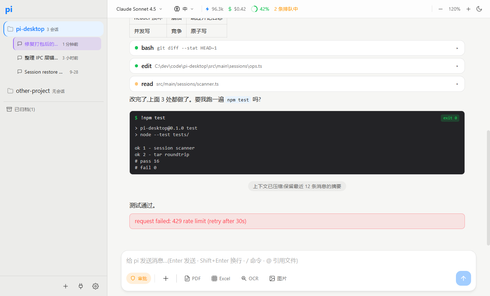
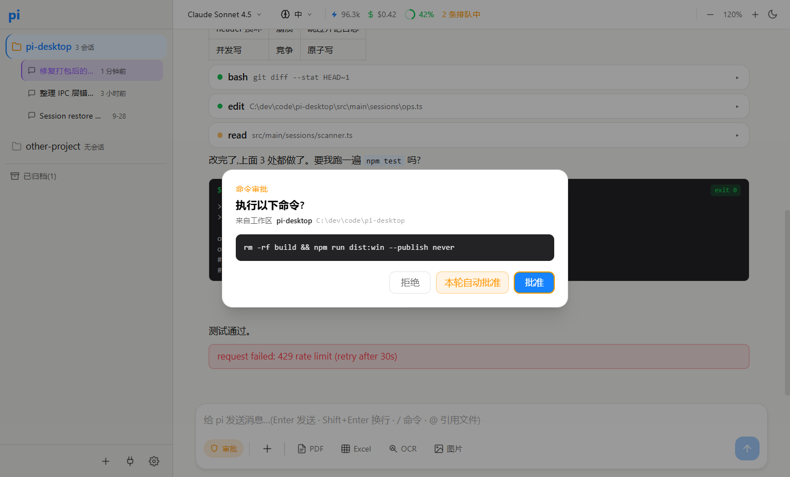
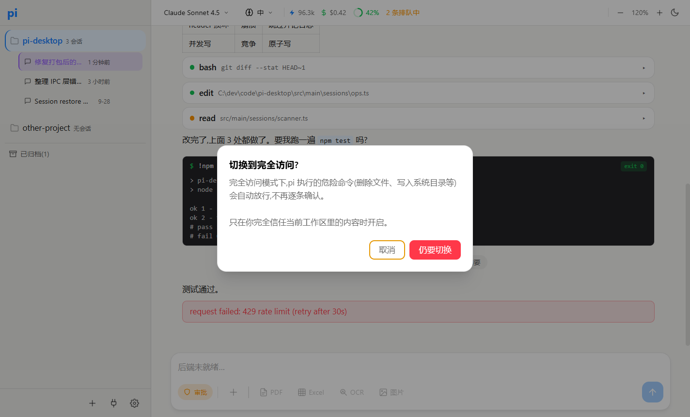
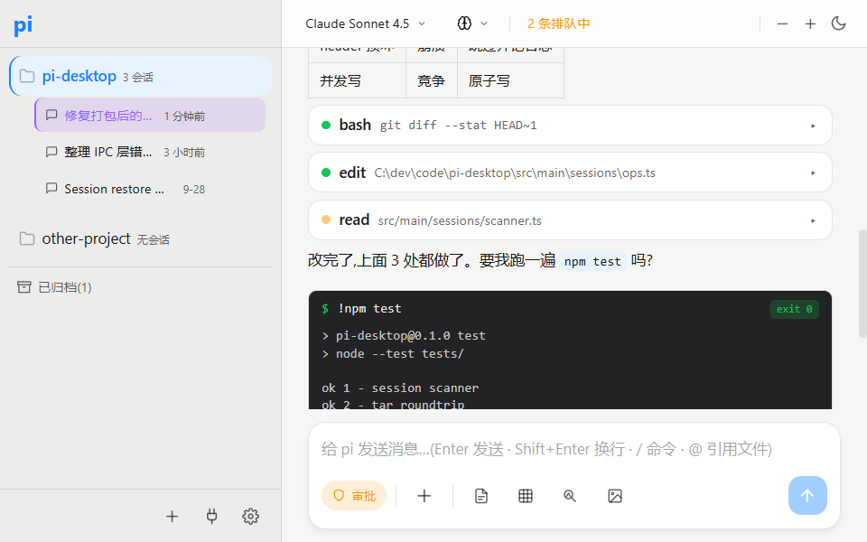
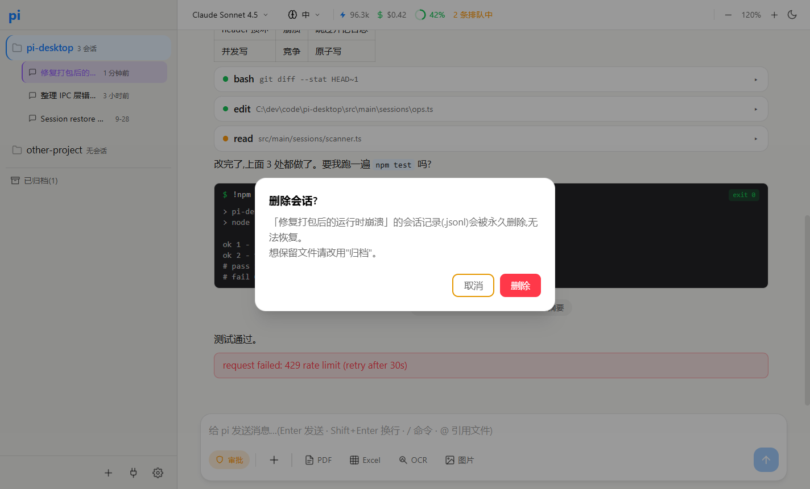

**验证**：`npm run verify` → typecheck ✔ / oxlint 0 warning 0 error / 16 单测 + 3 套脚本测试全通过。

### 批次 2（交互）—— ✅ 2026-10-28

| 问题 | 改动 |
| --- | --- |
| P2-1 斜杠补全 | 弹层 `max-h-72 overflow-y-auto`;命令名 `whitespace-nowrap + truncate`;描述 `flex-1 min-w-0 truncate`;行高 `py-2 → py-1.5`。实测 8 项高度 **640px → 257px**，单行 32px |
| P2-2 `@` 路径 | `listFiles` 查询与路径统一按 `/` 归一化（`\`→`/`）；EXCLUDE 增加 `release / .venv / venv / vendor / tmp / .dsh`。实测 `@src/main` 从 **0 条 → 29 条**，不再出现 `release/win-unpacked` |
| P2-3 弹窗统一 | 设置、MCP 页、审批、安装进度全部改用 `Modal`：Esc 关闭、点遮罩关闭、焦点陷阱、打开聚焦首个可交互项、关闭后焦点归位；安装进度改为独立 Modal（原来嵌在带 transform 的面板里，fixed 层会被裁剪） |
| P2-4 导航键盘 | 工作区行、会话行拆成"容器 + 内部 `<button>`"（原来 `
`，且内部再嵌 `<button>` 属非法嵌套）；`aria-expanded` 标注展开态 |
| P2-5 悬停按钮 | 全部加 `group-focus-within:opacity-100` + `focus-visible:opacity-100`；全局 `:focus-visible` 统一 2px accent 焦点环，替代浏览器默认细橙圈 |
| P2-6 aria-label | 侧栏 3 个、工作区 2 个、会话 2 个、输入区 6 个、状态栏 3 个图标按钮补齐 `aria-label` |
| P2-8 滚动吸附 | `MessageList` 的吸附重置依赖改为 `[activeCwd, activeSessionFile]`，同工作区切会话也会回到底部 |
| P2-9 草稿隔离 | `Composer` 按 cwd 存草稿（文本 / 图片 / 文件引用），切工作区自动换、回来还在；用"渲染期修正 state"避免旧文本写进新工作区 |
| P2-10 消息操作 | 代码块右上角"复制"（hover/聚焦出现）；assistant 消息 hover 出现"复制"；错误块加"复制错误 / 重发上一条"（pi RPC 无回退语义，按钮文案如实写"重发"） |
| P2-13 首启引导 | 无工作区时中央给"添加工作区 / 配置模型"两个 CTA；输入框禁用并提示"先添加一个工作区…"，避免消息发到列表里看不见的目录 |
| P2-14 设置入口 | 设置左栏底部新增"模型与密钥 →"，点击关闭设置并打开模型管理页 |
| P3-5 标题跳动 | 操作按钮改为 `group-focus-within` 显示后，行内宽度不再因 hover 抖动（按钮常驻占位，仅透明度变化） |

**实测**

| 项 | 结果 |
| --- | --- |
| 斜杠补全弹层 | 640px → **257px**，命令名不换行，描述单行截断 |
| `@src/main` | 0 条 → **29 条** |
| 设置弹窗 | 打开后焦点在"环境检测"；Esc / 点遮罩均关闭；焦点环为 accent |
| 会话行 | 可 Tab 聚焦，聚焦时归档/删除按钮 `opacity 1`（400ms 过渡后） |
| 草稿 | 在 A 输入 → 切 B（空）→ 回 A（原文还在） |
| 复制代码 | hover 后按钮 `opacity 1` |

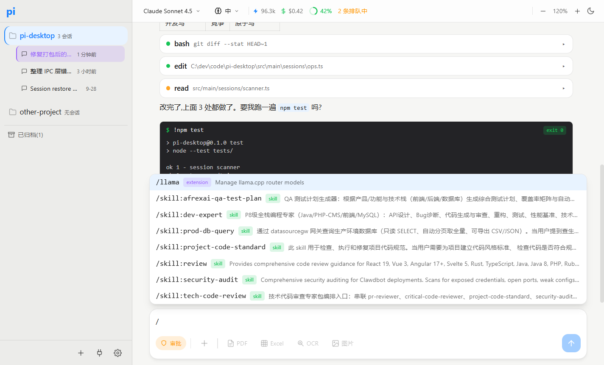
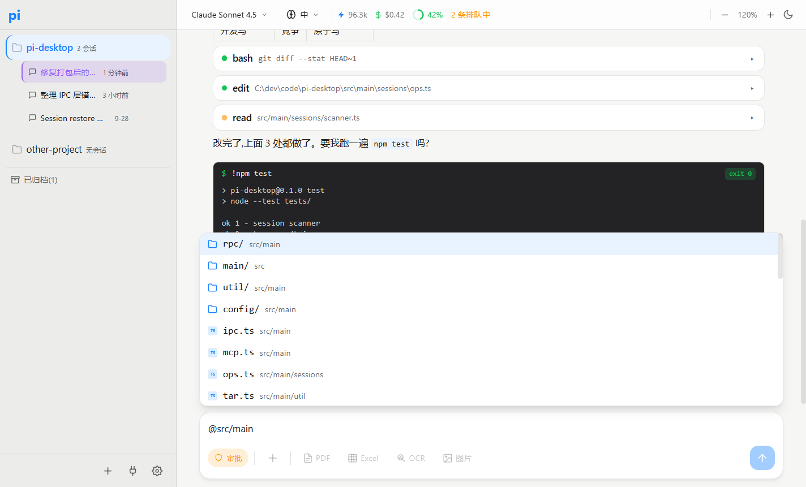
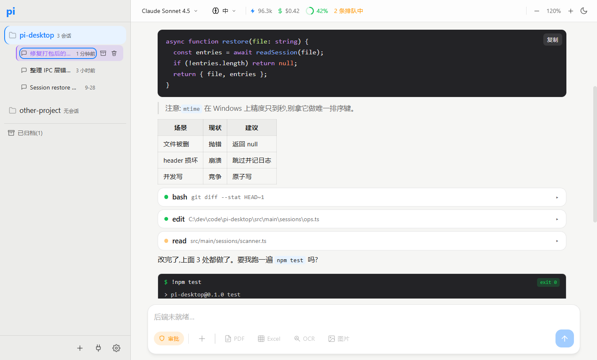
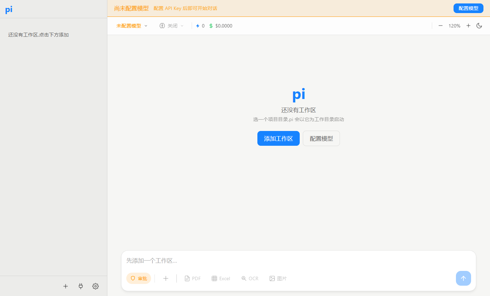
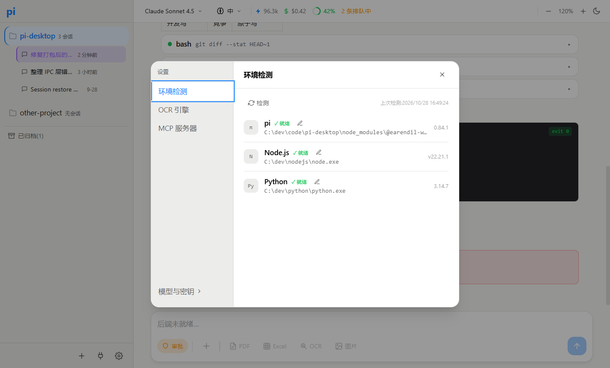

**验证**：`npm run verify` → typecheck ✔ / oxlint 0 warning 0 error / 16 单测 + 3 套脚本测试全通过。

### 批次 3（桌面化）—— ✅ 2026-10-28

**新增文件**

| 文件 | 作用 |
| --- | --- |
| `src/main/menu.ts` | 中文应用菜单 + 快捷键;动作经 `app:command` 下发给渲染端(缩放/主题只有一份状态) |
| `src/main/window-state.ts` | 窗口几何持久化(`userData/window-state.json`),越界坐标自动回退默认尺寸 |
| `src/renderer/src/store/theme.ts` | 主题 store(用户没手动选过时跟随系统变化) |

**改动**

| 问题 | 改动 |
| --- | --- |
| P2-12 菜单/快捷键 | 文件(新建会话 Ctrl+N / 添加工作区 Ctrl+O / 设置 Ctrl+, / 模型与密钥 / 关闭 Ctrl+W / 退出)、编辑、视图(放大 Ctrl+= / 缩小 Ctrl+- / 重置 Ctrl+0 / 切换深浅色 Ctrl+Shift+L / 全屏)、窗口、帮助(关于)。**Reload 与 DevTools 只在 dev 菜单出现**,生产不可达 |
| 右键菜单 | `webContents.on("context-menu")`:编辑区给撤销/重做/剪切/复制/粘贴/全选(按 editFlags 置灰),选中文本给复制,链接给"浏览器打开/复制地址" |
| P2-11 窗口状态 | 启动恢复 bounds(实测打包版恢复到 1200×780 @ 300,120)+ 最大化状态;`show:false` + `ready-to-show`;`backgroundColor` 跟随系统深浅色(不再白闪);dev 下窗口图标用 `build/icon.png` |
| 首启体验 | 打包版首次需要解包时先弹一个无边框提示窗("正在准备运行时"),主窗口 `ready-to-show` 后关闭 |
| 拖放/粘贴 | 输入卡片支持拖入文件/图片(高亮提示"松开以添加附件"),支持粘贴截图(`clipboardData.items` 里的图片);窗口级 `dragover/drop` 兜底阻止导航 |
| P2-7 对比度 | 新增 `--orange-fg / --red-fg / --green-fg / --purple-fg / --diff-add-fg / --diff-del-fg` 与 Tailwind 语义色 `text-warn / danger / ok / info / diff-add / diff-del`;用户气泡 `#1783ff → #0f6fd8`;亮色 `--purple` 调深 |
| P3-1 缩放提示 | 去掉不存在的"Ctrl+滚轮"提示,改为 Ctrl+= / Ctrl+-;**实测快捷键可用**(120% → 140%,localStorage 同步) |
| P3-7 零值噪声 | 无用量时不再显示 `0` / `$0.0000`;上下文占用未知时不渲染环形 |
| P3-8 跟随系统 | 未手动选择主题时监听 `prefers-color-scheme` 变化 |
| P3-10 无障碍 | 主界面补 `sr-only` h1;Toast 容器 `role="status" aria-live="polite"` |
| P3-11 dev 图标 | dev 下 `BrowserWindow.icon` 指向 `build/icon.png`(截图里标题栏已是 pi 图标) |

**对比度实测(浅色)**

| 元素 | 修复前 | 修复后 |
| --- | --- | --- |
| 用户气泡白字 | 3.67:1 | **4.9:1** |
| diff 新增行 | 2.32:1 | **6.63:1** |
| 审批药丸橙字 | ≈2.2:1 | **5.02:1** |
| 错误块红字 | ≈3.0:1 | **5.48:1** |

**打包验证**

- `npm run build` ✔(main/preload/renderer 全部重建)
- `electron-builder --dir` 冒烟:打包版从 `app.asar` 启动、菜单为中文、窗口几何恢复、空状态 CTA 与 aria-live 均生效,控制台无报错。
- ⚠️ 本机环境注意:连续多次打包后 `electron-builder` 的 electron 解包 / rcedit 会被杀软短暂占用,报 `EPERM: rename win-unpacked.tmp` 或 `UNKNOWN: open pi-desktop.exe`。本次冒烟用 `--config.electronDist=node_modules/electron/dist --config.win.signAndEditExecutable=false` 绕过(exe 图标嵌入在之前的完整 `dist:win` 中已验证过);正式出包时若遇到,重试或临时关闭实时扫描即可。

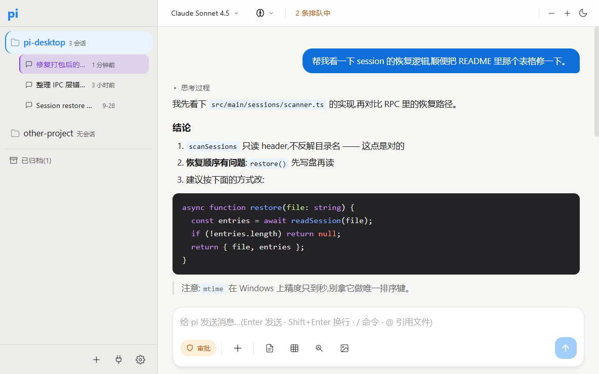
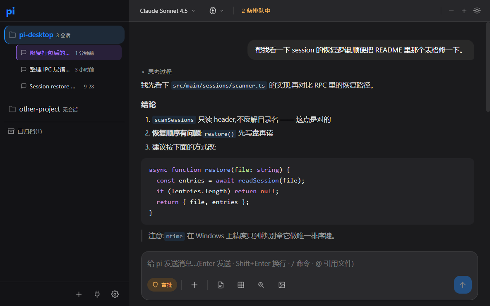
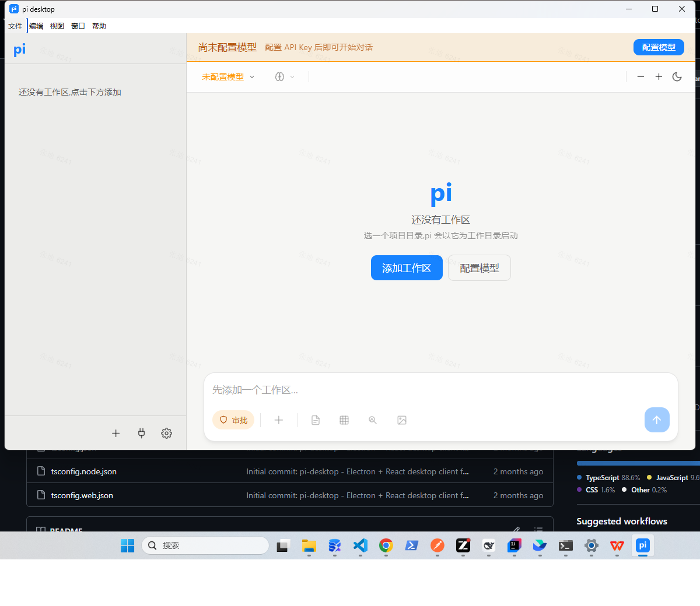
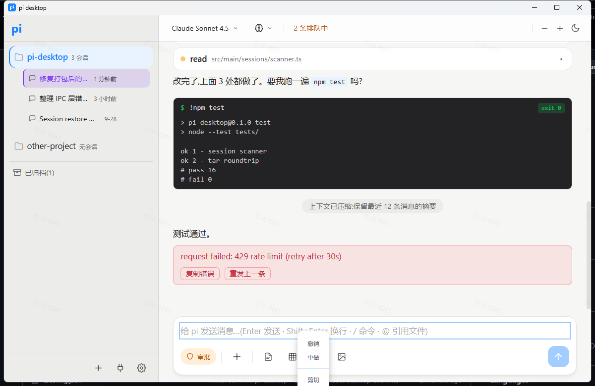
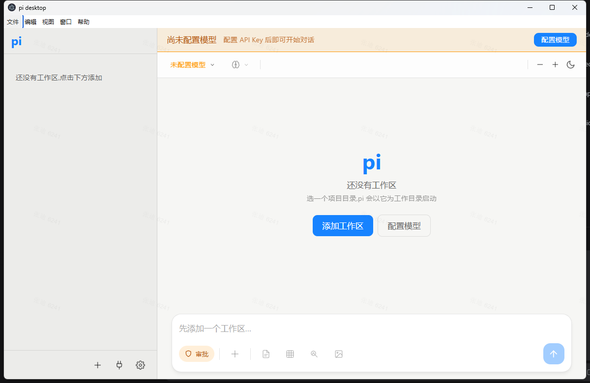

**验证**:`npm run verify` → typecheck ✔ / oxlint 0 warning 0 error / 16 单测 + 3 套脚本测试全通过。

---

## 7. 三批修复后的整体结论

| 维度 | 修复前 | 修复后 |
| --- | --- | --- |
| 安全 UX | 3/10 | **8/10** —— 审批主次正确、完全访问需确认且红色告警、删除全部二次确认 |
| 布局健壮性 | 4/10 | **8/10** —— 最小窗口状态栏不再溢出,输入区 210px → 122px |
| 交互完整性 | 4/10 | **8/10** —— 菜单/快捷键/右键/拖放/粘贴/焦点管理全部到位 |
| 无障碍 | 4/10 | **7/10** —— 焦点环统一、图标按钮有 aria-label、Toast 可播报;仍缺完整读屏测试 |
| 桌面化程度 | 3/10 | **8/10** —— 窗口状态、启动背景、首启提示、中文菜单 |

仍然存在、但属于后续迭代的项:

1. 会话删除/归档只能单条操作,没有多选与撤销(现在是二次确认);
2. 消息列表仍是"窗口 60 条 + 展开全部",超大历史展开会一次性渲染;
3. 模型管理的自定义模型仍需手写 `id|名称` 文本域,没有"从 /models 拉取";
4. 没有自动更新与崩溃上报;
5. macOS 未做打包与签名验证;
6. 读屏软件实测(仅做了语义与对比度层面的修正);
7. 主题跟随系统依赖 `prefers-color-scheme`,Windows 下与系统"应用模式"一致,但切换需要系统广播,极端情况下要重开窗口。
